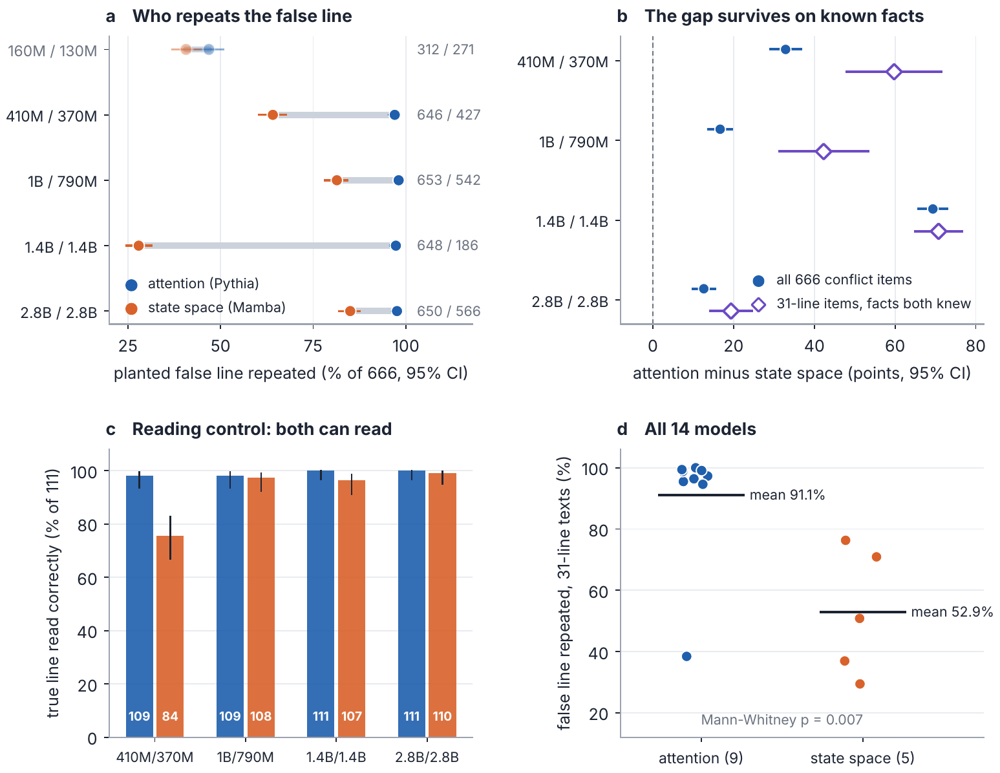

<div align="center">

<picture>
  <source media="(prefers-color-scheme: dark)" srcset="assets/hero-dark.svg">
  <source media="(prefers-color-scheme: light)" srcset="assets/hero-light.svg">
  
</picture>

<br>

<a href="#03-results"></a>
<a href="#03-results"></a>
<a href="#02-design"></a>
<a href="LICENSE"></a>
<a href="https://rejaulkorimsadi.github.io/The-Attention-Ablation-Test/"></a>

<sub>Study A of the B.Sc. thesis <b><i>MRI of a Mad Machine: The Structural Origins of Hallucination</i></b> · Department of CSE, Metropolitan University, Sylhet</sub>

<sub><a href="#01-the-question">Question</a> · <a href="#02-design">Design</a> · <a href="#03-results">Results</a> · <a href="#04-what-it-means">Meaning</a> · <a href="#05-reproduce">Reproduce</a> · <a href="#06-files">Files</a> · <a href="#07-cite">Cite</a></sub>

</div>

<br>

<a id="01-the-question"></a>
<picture>
  <source media="(prefers-color-scheme: dark)" srcset="assets/r01-dark.svg">
  <source media="(prefers-color-scheme: light)" srcset="assets/r01-light.svg">
  
</picture>

A language model can repeat a false sentence from its input in the same confident voice it uses for the truth. Is **self-attention** the part of the model that lets that happen?

To answer it, everything else has to stay fixed. **Pythia** (attention) and **Mamba** (selective state space) were trained on **the same data** (the Pile) with **the same tokenizer** (GPT-NeoX) at matched sizes. The only manipulated variable is how the model mixes information across the sequence. Any behavioural difference can therefore be attributed to the mixer, not to data or scale.

<br>

<a id="02-design"></a>
<picture>
  <source media="(prefers-color-scheme: dark)" srcset="assets/r02-dark.svg">
  <source media="(prefers-color-scheme: light)" srcset="assets/r02-light.svg">
  
</picture>

| | |
|---|---|
| **Matched pairs** | Pythia-160M / Mamba-130M · 410M / 370M · 1B / 790M · 1.4B / 1.4B · 2.8B / 2.8B |
| **Further attention models** | Qwen2.5-0.5B, 1.5B, 3B · SmolLM2-1.7B (14 models in total) |
| **Probe 1: free recall** | 200 SimpleQA questions, 2.8B pair, greedy decoding, three-shot prompt. Two annotators scored blind into correct / factual error / abstention / degenerate (Cohen's κ = 0.85) |
| **Probe 2: context conflict** | 111 facts (capitals, chemical symbols, currencies, book authors, painters, planet facts) × 9 conditions = 999 items per model, 666 of them conflict items. Scored automatically |
| **Hardware** | One ASUS A16 laptop, RTX 5050 (8 GB). Models run one at a time, fp16 |

<picture>
  <source media="(prefers-color-scheme: dark)" srcset="assets/design-dark.svg">
  <source media="(prefers-color-scheme: light)" srcset="assets/design-light.svg">
  
</picture>

<br>

<a id="03-results"></a>
<picture>
  <source media="(prefers-color-scheme: dark)" srcset="assets/r03-dark.svg">
  <source media="(prefers-color-scheme: light)" srcset="assets/r03-light.svg">
  
</picture>

<picture>
  <source media="(prefers-color-scheme: dark)" srcset="assets/two_probes-dark.svg">
  <source media="(prefers-color-scheme: light)" srcset="assets/two_probes-light.svg">
  
</picture>

<picture>
  <source media="(prefers-color-scheme: dark)" srcset="assets/results-dark.svg">
  <source media="(prefers-color-scheme: light)" srcset="assets/results-light.svg">
  
</picture>

| What we measured | Attention · Pythia-2.8B | State space · Mamba-2.8B | Test |
|---|:---:|:---:|:---:|
| Free recall: SimpleQA answered correctly, of 200 | 3 | 3 | p = 1.000 |
| Planted false line repeated, of 666 | **650** | **566** | **90 vs 6 discordant · p = 2.5 × 10⁻²⁰** |
| Same, on facts **both models knew** (31-line texts), of 279 | **264** | **210** | **p = 9.0 × 10⁻¹³** |
| Planted true line read correctly (31-line texts), of 111 | 111 | 110 | reading control |

<details>
<summary><b>All five matched pairs</b> (conflict items followed, of 666)</summary>

| Pair (attention vs state space) | Pythia | Mamba | Discordant | Exact McNemar p |
|---|:---:|:---:|:---:|:---:|
| 160M vs 130M | 312 | 271 | 152 / 111 | 0.0135 |
| 410M vs 370M | 646 | 427 | 228 / 9 | 5.3 × 10⁻⁵⁶ |
| 1B vs 790M | 653 | 542 | 113 / 2 | 3.2 × 10⁻³¹ |
| 1.4B vs 1.4B | 648 | 186 | **462 / 0** | 1.7 × 10⁻¹³⁹ |
| 2.8B vs 2.8B | 650 | 566 | 90 / 6 | 2.5 × 10⁻²⁰ |

Group test on the 31-line texts, all 14 models: attention mean 91.1% vs state space 52.9% (Mann-Whitney p = 0.007). At 160M the pattern is mixed: on facts both models knew, the attention model followed the false line less often (8 vs 14 of 15).
</details>

<p align="center">
  
  <br><sub><b>Publication figure.</b> a, share of the 666 conflict items on which each model repeated the planted false line (Wilson 95% intervals). b, paired difference, all items vs facts both models knew. c, reading control. d, all 14 models. Vector versions are in <code>figures/</code>.</sub>
</p>

<br>

<a id="04-what-it-means"></a>
<picture>
  <source media="(prefers-color-scheme: dark)" srcset="assets/r04-dark.svg">
  <source media="(prefers-color-scheme: light)" srcset="assets/r04-light.svg">
  
</picture>

> [!IMPORTANT]
> Removing attention leaves **recall from memory** unchanged. It changes whether a **passage can override what the model knows**, even when the model knew better.

Attention is the machinery of context grounding, and it cuts both ways. It is what makes in-context and retrieval-augmented use work when the text is true, and a direct route to confident error when the text is false. A retrieval system built on an attention model will tend to repeat what it retrieves, so the provenance of retrieved text matters as much as the model.

**Honest bounds.** These are behavioural measurements, so they say what the mixer does, not which circuit does it. Part of the state-space models' resistance is a known limit of state-space models at in-context retrieval, which is why the reading control and the known-facts test are reported beside the main result. The comparison covers base models from 130M to 2.8B; larger and hybrid architectures are the natural next step.

<details>
<summary><b>Note on the 24-fact pilot</b> (kept for the record, with a correction)</summary>

An earlier pilot used 24 facts and 9-line texts (`study1b_pilot/`). In that pilot **both 2.8B models followed the planted statement on all 72 context items**, and the **1.4B pair** separated: Pythia-1.4B 70 of 72, Mamba-1.4B 17 of 72 (53 vs 0 discordant). A previous version of this README credited the 70/72 vs 17/72 split to the 2.8B pair and to 31-line texts; it belongs to the 1.4B pair and 9-line texts. The final 111-fact probe removes the pilot's ceiling, replicates the 1.4B split and also separates the 2.8B pair.
</details>

<br>

<a id="05-reproduce"></a>
<picture>
  <source media="(prefers-color-scheme: dark)" srcset="assets/r05-dark.svg">
  <source media="(prefers-color-scheme: light)" srcset="assets/r05-light.svg">
  
</picture>

**Recompute every reported number from the released files** (no GPU needed; run in PowerShell inside the repository):

```powershell
py -m pip install pandas scipy statsmodels; py code\analyze_study1a.py; cd study1b; py code\analyze_probe.py; py code\tables_by_model.py; py code\controls_known_facts.py; cd ..
```

Expected lines include `Cohen's kappa: 0.853`, `paired correct ... exact McNemar p=1.000` and `pythia-2.8b vs mamba-2.8b-hf all n=666 followed 650 vs 566 ... McNemar p=2.5e-20`.

**Regenerate the model outputs** (one 8 GB GPU; the RTX 5050 is Blackwell and needs the CUDA 12.8 build of PyTorch):

```powershell
py -3.12 -m venv p5env; .\p5env\Scripts\Activate.ps1; pip install --index-url https://download.pytorch.org/whl/cu128 torch; pip install -r requirements.txt; python code\run_free_recall.py run --model EleutherAI/pythia-2.8b --pool data\questions.json --out data\outputs_pythia_2_8b.json; python code\run_free_recall.py run --model state-spaces/mamba-2.8b-hf --pool data\questions.json --out data\outputs_mamba_2_8b.json
```

For the 14-model context probe see [`study1b/README.md`](study1b/README.md) (about 3–4 hours for all 14 models; `run_probe.py` resumes from existing files).

<br>

<a id="06-files"></a>
<picture>
  <source media="(prefers-color-scheme: dark)" srcset="assets/r06-dark.svg">
  <source media="(prefers-color-scheme: light)" srcset="assets/r06-light.svg">
  
</picture>

```text
The-Attention-Ablation-Test/
├── code/
│   ├── run_free_recall.py          runs a model over the 200 questions; builds the blind sheet
│   └── analyze_study1a.py          agreement, label counts, paired McNemar tests
├── data/                           probe 1: free recall
│   ├── questions.json              200 SimpleQA questions (seed 42)
│   ├── outputs_pythia_2_8b.json    raw outputs
│   ├── outputs_mamba_2_8b.json     raw outputs
│   ├── scoresheet_blind.csv        shuffled, de-identified sheet the annotators scored
│   ├── model_key.csv               response-to-model key, opened only after scoring
│   └── annotator_A.csv, annotator_B.csv   independent blind labels
├── study1b/                        probe 2: context conflict, 14 models
│   ├── pool_probe_v2.json          999 items with prompts
│   ├── outputs/*.jsonl             raw outputs, 999 lines per model
│   ├── results/                    per-model rates, pair tests, every scored item
│   └── code/                       build, run, score, tables, known-facts control
├── study1b_pilot/                  the earlier 24-fact pilot
├── figures/                        publication figures (PNG + PDF)
├── notebooks/                      notebook mirror of the free-recall setup
├── assets/                         artwork for this page (light and dark)
├── docs/                           this page as a website (GitHub Pages)
├── .github/                        issue and pull-request templates
├── CITATION.cff · LICENSE · LICENSE-DATA.md · requirements.txt
├── CONTRIBUTING.md · CODE_OF_CONDUCT.md · SECURITY.md · .zenodo.json
```

<details>
<summary><b>Where the old file names went</b></summary>

| Old name | New location |
|---|---|
| `p5_local_harness_v2.py` | `code/run_free_recall.py` (same code) |
| `pool_v2.json` | `data/questions.json` |
| `pythia_2_8b.json`, `mamba_2_8b.json` | `data/outputs_pythia_2_8b.json`, `data/outputs_mamba_2_8b.json` |
| `p5_scoresheet_BLIND.csv` | `data/scoresheet_blind.csv` |
| `p5_key_SEALED.csv` | `data/model_key.csv` |
| `p5_scored_SADI.csv`, `p5_scored_DEWAN.csv` | `data/annotator_A.csv`, `data/annotator_B.csv` |
| `Thesis_2_0_RTX5050.ipynb` | `notebooks/Thesis_2_0_RTX5050.ipynb` |
</details>

<br>

### The two architectures in 3D

Two stacks on the same footing: attention (red layers) and state space (teal layers), five layers each.

<p align="center">
<picture>
  <source media="(prefers-color-scheme: dark)" srcset="assets/turntable-dark.gif">
  <source media="(prefers-color-scheme: light)" srcset="assets/turntable-light.gif">
  
</picture>
</p>

The same model as an interactive object: **drag to rotate, scroll to zoom.**

```stl
solid attention_vs_state_space
 facet normal 0.000 0.000 -1.000
  outer loop
   vertex -47.00 -17.00 0.00
   vertex -13.00 17.00 0.00
   vertex -13.00 -17.00 0.00
  endloop
 endfacet
 facet normal 0.000 0.000 -1.000
  outer loop
   vertex -47.00 -17.00 0.00
   vertex -47.00 17.00 0.00
   vertex -13.00 17.00 0.00
  endloop
 endfacet
 facet normal 0.000 0.000 1.000
  outer loop
   vertex -47.00 -17.00 6.00
   vertex -13.00 -17.00 6.00
   vertex -13.00 17.00 6.00
  endloop
 endfacet
 facet normal 0.000 0.000 1.000
  outer loop
   vertex -47.00 -17.00 6.00
   vertex -13.00 17.00 6.00
   vertex -47.00 17.00 6.00
  endloop
 endfacet
 facet normal 0.000 -1.000 0.000
  outer loop
   vertex -47.00 -17.00 0.00
   vertex -13.00 -17.00 0.00
   vertex -13.00 -17.00 6.00
  endloop
 endfacet
 facet normal 0.000 -1.000 0.000
  outer loop
   vertex -47.00 -17.00 0.00
   vertex -13.00 -17.00 6.00
   vertex -47.00 -17.00 6.00
  endloop
 endfacet
 facet normal 1.000 0.000 0.000
  outer loop
   vertex -13.00 -17.00 0.00
   vertex -13.00 17.00 0.00
   vertex -13.00 17.00 6.00
  endloop
 endfacet
 facet normal 1.000 0.000 0.000
  outer loop
   vertex -13.00 -17.00 0.00
   vertex -13.00 17.00 6.00
   vertex -13.00 -17.00 6.00
  endloop
 endfacet
 facet normal 0.000 1.000 0.000
  outer loop
   vertex -13.00 17.00 0.00
   vertex -47.00 17.00 0.00
   vertex -47.00 17.00 6.00
  endloop
 endfacet
 facet normal 0.000 1.000 -0.000
  outer loop
   vertex -13.00 17.00 0.00
   vertex -47.00 17.00 6.00
   vertex -13.00 17.00 6.00
  endloop
 endfacet
 facet normal -1.000 0.000 0.000
  outer loop
   vertex -47.00 17.00 0.00
   vertex -47.00 -17.00 0.00
   vertex -47.00 -17.00 6.00
  endloop
 endfacet
 facet normal -1.000 0.000 0.000
  outer loop
   vertex -47.00 17.00 0.00
   vertex -47.00 -17.00 6.00
   vertex -47.00 17.00 6.00
  endloop
 endfacet
 facet normal 0.000 0.000 -1.000
  outer loop
   vertex -47.00 -17.00 11.00
   vertex -13.00 17.00 11.00
   vertex -13.00 -17.00 11.00
  endloop
 endfacet
 facet normal 0.000 0.000 -1.000
  outer loop
   vertex -47.00 -17.00 11.00
   vertex -47.00 17.00 11.00
   vertex -13.00 17.00 11.00
  endloop
 endfacet
 facet normal 0.000 0.000 1.000
  outer loop
   vertex -47.00 -17.00 17.00
   vertex -13.00 -17.00 17.00
   vertex -13.00 17.00 17.00
  endloop
 endfacet
 facet normal 0.000 0.000 1.000
  outer loop
   vertex -47.00 -17.00 17.00
   vertex -13.00 17.00 17.00
   vertex -47.00 17.00 17.00
  endloop
 endfacet
 facet normal 0.000 -1.000 0.000
  outer loop
   vertex -47.00 -17.00 11.00
   vertex -13.00 -17.00 11.00
   vertex -13.00 -17.00 17.00
  endloop
 endfacet
 facet normal 0.000 -1.000 0.000
  outer loop
   vertex -47.00 -17.00 11.00
   vertex -13.00 -17.00 17.00
   vertex -47.00 -17.00 17.00
  endloop
 endfacet
 facet normal 1.000 0.000 0.000
  outer loop
   vertex -13.00 -17.00 11.00
   vertex -13.00 17.00 11.00
   vertex -13.00 17.00 17.00
  endloop
 endfacet
 facet normal 1.000 0.000 0.000
  outer loop
   vertex -13.00 -17.00 11.00
   vertex -13.00 17.00 17.00
   vertex -13.00 -17.00 17.00
  endloop
 endfacet
 facet normal 0.000 1.000 0.000
  outer loop
   vertex -13.00 17.00 11.00
   vertex -47.00 17.00 11.00
   vertex -47.00 17.00 17.00
  endloop
 endfacet
 facet normal 0.000 1.000 -0.000
  outer loop
   vertex -13.00 17.00 11.00
   vertex -47.00 17.00 17.00
   vertex -13.00 17.00 17.00
  endloop
 endfacet
 facet normal -1.000 0.000 0.000
  outer loop
   vertex -47.00 17.00 11.00
   vertex -47.00 -17.00 11.00
   vertex -47.00 -17.00 17.00
  endloop
 endfacet
 facet normal -1.000 0.000 0.000
  outer loop
   vertex -47.00 17.00 11.00
   vertex -47.00 -17.00 17.00
   vertex -47.00 17.00 17.00
  endloop
 endfacet
 facet normal 0.000 0.000 -1.000
  outer loop
   vertex -47.00 -17.00 22.00
   vertex -13.00 17.00 22.00
   vertex -13.00 -17.00 22.00
  endloop
 endfacet
 facet normal 0.000 0.000 -1.000
  outer loop
   vertex -47.00 -17.00 22.00
   vertex -47.00 17.00 22.00
   vertex -13.00 17.00 22.00
  endloop
 endfacet
 facet normal 0.000 0.000 1.000
  outer loop
   vertex -47.00 -17.00 28.00
   vertex -13.00 -17.00 28.00
   vertex -13.00 17.00 28.00
  endloop
 endfacet
 facet normal 0.000 0.000 1.000
  outer loop
   vertex -47.00 -17.00 28.00
   vertex -13.00 17.00 28.00
   vertex -47.00 17.00 28.00
  endloop
 endfacet
 facet normal 0.000 -1.000 0.000
  outer loop
   vertex -47.00 -17.00 22.00
   vertex -13.00 -17.00 22.00
   vertex -13.00 -17.00 28.00
  endloop
 endfacet
 facet normal 0.000 -1.000 0.000
  outer loop
   vertex -47.00 -17.00 22.00
   vertex -13.00 -17.00 28.00
   vertex -47.00 -17.00 28.00
  endloop
 endfacet
 facet normal 1.000 0.000 0.000
  outer loop
   vertex -13.00 -17.00 22.00
   vertex -13.00 17.00 22.00
   vertex -13.00 17.00 28.00
  endloop
 endfacet
 facet normal 1.000 0.000 0.000
  outer loop
   vertex -13.00 -17.00 22.00
   vertex -13.00 17.00 28.00
   vertex -13.00 -17.00 28.00
  endloop
 endfacet
 facet normal 0.000 1.000 0.000
  outer loop
   vertex -13.00 17.00 22.00
   vertex -47.00 17.00 22.00
   vertex -47.00 17.00 28.00
  endloop
 endfacet
 facet normal 0.000 1.000 -0.000
  outer loop
   vertex -13.00 17.00 22.00
   vertex -47.00 17.00 28.00
   vertex -13.00 17.00 28.00
  endloop
 endfacet
 facet normal -1.000 0.000 0.000
  outer loop
   vertex -47.00 17.00 22.00
   vertex -47.00 -17.00 22.00
   vertex -47.00 -17.00 28.00
  endloop
 endfacet
 facet normal -1.000 0.000 0.000
  outer loop
   vertex -47.00 17.00 22.00
   vertex -47.00 -17.00 28.00
   vertex -47.00 17.00 28.00
  endloop
 endfacet
 facet normal 0.000 0.000 -1.000
  outer loop
   vertex -47.00 -17.00 33.00
   vertex -13.00 17.00 33.00
   vertex -13.00 -17.00 33.00
  endloop
 endfacet
 facet normal 0.000 0.000 -1.000
  outer loop
   vertex -47.00 -17.00 33.00
   vertex -47.00 17.00 33.00
   vertex -13.00 17.00 33.00
  endloop
 endfacet
 facet normal 0.000 0.000 1.000
  outer loop
   vertex -47.00 -17.00 39.00
   vertex -13.00 -17.00 39.00
   vertex -13.00 17.00 39.00
  endloop
 endfacet
 facet normal 0.000 0.000 1.000
  outer loop
   vertex -47.00 -17.00 39.00
   vertex -13.00 17.00 39.00
   vertex -47.00 17.00 39.00
  endloop
 endfacet
 facet normal 0.000 -1.000 0.000
  outer loop
   vertex -47.00 -17.00 33.00
   vertex -13.00 -17.00 33.00
   vertex -13.00 -17.00 39.00
  endloop
 endfacet
 facet normal 0.000 -1.000 0.000
  outer loop
   vertex -47.00 -17.00 33.00
   vertex -13.00 -17.00 39.00
   vertex -47.00 -17.00 39.00
  endloop
 endfacet
 facet normal 1.000 0.000 0.000
  outer loop
   vertex -13.00 -17.00 33.00
   vertex -13.00 17.00 33.00
   vertex -13.00 17.00 39.00
  endloop
 endfacet
 facet normal 1.000 0.000 0.000
  outer loop
   vertex -13.00 -17.00 33.00
   vertex -13.00 17.00 39.00
   vertex -13.00 -17.00 39.00
  endloop
 endfacet
 facet normal 0.000 1.000 0.000
  outer loop
   vertex -13.00 17.00 33.00
   vertex -47.00 17.00 33.00
   vertex -47.00 17.00 39.00
  endloop
 endfacet
 facet normal 0.000 1.000 -0.000
  outer loop
   vertex -13.00 17.00 33.00
   vertex -47.00 17.00 39.00
   vertex -13.00 17.00 39.00
  endloop
 endfacet
 facet normal -1.000 0.000 0.000
  outer loop
   vertex -47.00 17.00 33.00
   vertex -47.00 -17.00 33.00
   vertex -47.00 -17.00 39.00
  endloop
 endfacet
 facet normal -1.000 0.000 0.000
  outer loop
   vertex -47.00 17.00 33.00
   vertex -47.00 -17.00 39.00
   vertex -47.00 17.00 39.00
  endloop
 endfacet
 facet normal 0.000 0.000 -1.000
  outer loop
   vertex -47.00 -17.00 44.00
   vertex -13.00 17.00 44.00
   vertex -13.00 -17.00 44.00
  endloop
 endfacet
 facet normal 0.000 0.000 -1.000
  outer loop
   vertex -47.00 -17.00 44.00
   vertex -47.00 17.00 44.00
   vertex -13.00 17.00 44.00
  endloop
 endfacet
 facet normal 0.000 0.000 1.000
  outer loop
   vertex -47.00 -17.00 50.00
   vertex -13.00 -17.00 50.00
   vertex -13.00 17.00 50.00
  endloop
 endfacet
 facet normal 0.000 0.000 1.000
  outer loop
   vertex -47.00 -17.00 50.00
   vertex -13.00 17.00 50.00
   vertex -47.00 17.00 50.00
  endloop
 endfacet
 facet normal 0.000 -1.000 0.000
  outer loop
   vertex -47.00 -17.00 44.00
   vertex -13.00 -17.00 44.00
   vertex -13.00 -17.00 50.00
  endloop
 endfacet
 facet normal 0.000 -1.000 0.000
  outer loop
   vertex -47.00 -17.00 44.00
   vertex -13.00 -17.00 50.00
   vertex -47.00 -17.00 50.00
  endloop
 endfacet
 facet normal 1.000 0.000 0.000
  outer loop
   vertex -13.00 -17.00 44.00
   vertex -13.00 17.00 44.00
   vertex -13.00 17.00 50.00
  endloop
 endfacet
 facet normal 1.000 0.000 0.000
  outer loop
   vertex -13.00 -17.00 44.00
   vertex -13.00 17.00 50.00
   vertex -13.00 -17.00 50.00
  endloop
 endfacet
 facet normal 0.000 1.000 0.000
  outer loop
   vertex -13.00 17.00 44.00
   vertex -47.00 17.00 44.00
   vertex -47.00 17.00 50.00
  endloop
 endfacet
 facet normal 0.000 1.000 -0.000
  outer loop
   vertex -13.00 17.00 44.00
   vertex -47.00 17.00 50.00
   vertex -13.00 17.00 50.00
  endloop
 endfacet
 facet normal -1.000 0.000 0.000
  outer loop
   vertex -47.00 17.00 44.00
   vertex -47.00 -17.00 44.00
   vertex -47.00 -17.00 50.00
  endloop
 endfacet
 facet normal -1.000 0.000 0.000
  outer loop
   vertex -47.00 17.00 44.00
   vertex -47.00 -17.00 50.00
   vertex -47.00 17.00 50.00
  endloop
 endfacet
 facet normal 0.000 0.000 -1.000
  outer loop
   vertex 13.00 -17.00 0.00
   vertex 47.00 17.00 0.00
   vertex 47.00 -17.00 0.00
  endloop
 endfacet
 facet normal 0.000 0.000 -1.000
  outer loop
   vertex 13.00 -17.00 0.00
   vertex 13.00 17.00 0.00
   vertex 47.00 17.00 0.00
  endloop
 endfacet
 facet normal 0.000 0.000 1.000
  outer loop
   vertex 13.00 -17.00 6.00
   vertex 47.00 -17.00 6.00
   vertex 47.00 17.00 6.00
  endloop
 endfacet
 facet normal 0.000 0.000 1.000
  outer loop
   vertex 13.00 -17.00 6.00
   vertex 47.00 17.00 6.00
   vertex 13.00 17.00 6.00
  endloop
 endfacet
 facet normal 0.000 -1.000 0.000
  outer loop
   vertex 13.00 -17.00 0.00
   vertex 47.00 -17.00 0.00
   vertex 47.00 -17.00 6.00
  endloop
 endfacet
 facet normal 0.000 -1.000 0.000
  outer loop
   vertex 13.00 -17.00 0.00
   vertex 47.00 -17.00 6.00
   vertex 13.00 -17.00 6.00
  endloop
 endfacet
 facet normal 1.000 0.000 0.000
  outer loop
   vertex 47.00 -17.00 0.00
   vertex 47.00 17.00 0.00
   vertex 47.00 17.00 6.00
  endloop
 endfacet
 facet normal 1.000 0.000 0.000
  outer loop
   vertex 47.00 -17.00 0.00
   vertex 47.00 17.00 6.00
   vertex 47.00 -17.00 6.00
  endloop
 endfacet
 facet normal 0.000 1.000 0.000
  outer loop
   vertex 47.00 17.00 0.00
   vertex 13.00 17.00 0.00
   vertex 13.00 17.00 6.00
  endloop
 endfacet
 facet normal 0.000 1.000 -0.000
  outer loop
   vertex 47.00 17.00 0.00
   vertex 13.00 17.00 6.00
   vertex 47.00 17.00 6.00
  endloop
 endfacet
 facet normal -1.000 0.000 0.000
  outer loop
   vertex 13.00 17.00 0.00
   vertex 13.00 -17.00 0.00
   vertex 13.00 -17.00 6.00
  endloop
 endfacet
 facet normal -1.000 0.000 0.000
  outer loop
   vertex 13.00 17.00 0.00
   vertex 13.00 -17.00 6.00
   vertex 13.00 17.00 6.00
  endloop
 endfacet
 facet normal 0.000 0.000 -1.000
  outer loop
   vertex 13.00 -17.00 11.00
   vertex 47.00 17.00 11.00
   vertex 47.00 -17.00 11.00
  endloop
 endfacet
 facet normal 0.000 0.000 -1.000
  outer loop
   vertex 13.00 -17.00 11.00
   vertex 13.00 17.00 11.00
   vertex 47.00 17.00 11.00
  endloop
 endfacet
 facet normal 0.000 0.000 1.000
  outer loop
   vertex 13.00 -17.00 17.00
   vertex 47.00 -17.00 17.00
   vertex 47.00 17.00 17.00
  endloop
 endfacet
 facet normal 0.000 0.000 1.000
  outer loop
   vertex 13.00 -17.00 17.00
   vertex 47.00 17.00 17.00
   vertex 13.00 17.00 17.00
  endloop
 endfacet
 facet normal 0.000 -1.000 0.000
  outer loop
   vertex 13.00 -17.00 11.00
   vertex 47.00 -17.00 11.00
   vertex 47.00 -17.00 17.00
  endloop
 endfacet
 facet normal 0.000 -1.000 0.000
  outer loop
   vertex 13.00 -17.00 11.00
   vertex 47.00 -17.00 17.00
   vertex 13.00 -17.00 17.00
  endloop
 endfacet
 facet normal 1.000 0.000 0.000
  outer loop
   vertex 47.00 -17.00 11.00
   vertex 47.00 17.00 11.00
   vertex 47.00 17.00 17.00
  endloop
 endfacet
 facet normal 1.000 0.000 0.000
  outer loop
   vertex 47.00 -17.00 11.00
   vertex 47.00 17.00 17.00
   vertex 47.00 -17.00 17.00
  endloop
 endfacet
 facet normal 0.000 1.000 0.000
  outer loop
   vertex 47.00 17.00 11.00
   vertex 13.00 17.00 11.00
   vertex 13.00 17.00 17.00
  endloop
 endfacet
 facet normal 0.000 1.000 -0.000
  outer loop
   vertex 47.00 17.00 11.00
   vertex 13.00 17.00 17.00
   vertex 47.00 17.00 17.00
  endloop
 endfacet
 facet normal -1.000 0.000 0.000
  outer loop
   vertex 13.00 17.00 11.00
   vertex 13.00 -17.00 11.00
   vertex 13.00 -17.00 17.00
  endloop
 endfacet
 facet normal -1.000 0.000 0.000
  outer loop
   vertex 13.00 17.00 11.00
   vertex 13.00 -17.00 17.00
   vertex 13.00 17.00 17.00
  endloop
 endfacet
 facet normal 0.000 0.000 -1.000
  outer loop
   vertex 13.00 -17.00 22.00
   vertex 47.00 17.00 22.00
   vertex 47.00 -17.00 22.00
  endloop
 endfacet
 facet normal 0.000 0.000 -1.000
  outer loop
   vertex 13.00 -17.00 22.00
   vertex 13.00 17.00 22.00
   vertex 47.00 17.00 22.00
  endloop
 endfacet
 facet normal 0.000 0.000 1.000
  outer loop
   vertex 13.00 -17.00 28.00
   vertex 47.00 -17.00 28.00
   vertex 47.00 17.00 28.00
  endloop
 endfacet
 facet normal 0.000 0.000 1.000
  outer loop
   vertex 13.00 -17.00 28.00
   vertex 47.00 17.00 28.00
   vertex 13.00 17.00 28.00
  endloop
 endfacet
 facet normal 0.000 -1.000 0.000
  outer loop
   vertex 13.00 -17.00 22.00
   vertex 47.00 -17.00 22.00
   vertex 47.00 -17.00 28.00
  endloop
 endfacet
 facet normal 0.000 -1.000 0.000
  outer loop
   vertex 13.00 -17.00 22.00
   vertex 47.00 -17.00 28.00
   vertex 13.00 -17.00 28.00
  endloop
 endfacet
 facet normal 1.000 0.000 0.000
  outer loop
   vertex 47.00 -17.00 22.00
   vertex 47.00 17.00 22.00
   vertex 47.00 17.00 28.00
  endloop
 endfacet
 facet normal 1.000 0.000 0.000
  outer loop
   vertex 47.00 -17.00 22.00
   vertex 47.00 17.00 28.00
   vertex 47.00 -17.00 28.00
  endloop
 endfacet
 facet normal 0.000 1.000 0.000
  outer loop
   vertex 47.00 17.00 22.00
   vertex 13.00 17.00 22.00
   vertex 13.00 17.00 28.00
  endloop
 endfacet
 facet normal 0.000 1.000 -0.000
  outer loop
   vertex 47.00 17.00 22.00
   vertex 13.00 17.00 28.00
   vertex 47.00 17.00 28.00
  endloop
 endfacet
 facet normal -1.000 0.000 0.000
  outer loop
   vertex 13.00 17.00 22.00
   vertex 13.00 -17.00 22.00
   vertex 13.00 -17.00 28.00
  endloop
 endfacet
 facet normal -1.000 0.000 0.000
  outer loop
   vertex 13.00 17.00 22.00
   vertex 13.00 -17.00 28.00
   vertex 13.00 17.00 28.00
  endloop
 endfacet
 facet normal 0.000 0.000 -1.000
  outer loop
   vertex 13.00 -17.00 33.00
   vertex 47.00 17.00 33.00
   vertex 47.00 -17.00 33.00
  endloop
 endfacet
 facet normal 0.000 0.000 -1.000
  outer loop
   vertex 13.00 -17.00 33.00
   vertex 13.00 17.00 33.00
   vertex 47.00 17.00 33.00
  endloop
 endfacet
 facet normal 0.000 0.000 1.000
  outer loop
   vertex 13.00 -17.00 39.00
   vertex 47.00 -17.00 39.00
   vertex 47.00 17.00 39.00
  endloop
 endfacet
 facet normal 0.000 0.000 1.000
  outer loop
   vertex 13.00 -17.00 39.00
   vertex 47.00 17.00 39.00
   vertex 13.00 17.00 39.00
  endloop
 endfacet
 facet normal 0.000 -1.000 0.000
  outer loop
   vertex 13.00 -17.00 33.00
   vertex 47.00 -17.00 33.00
   vertex 47.00 -17.00 39.00
  endloop
 endfacet
 facet normal 0.000 -1.000 0.000
  outer loop
   vertex 13.00 -17.00 33.00
   vertex 47.00 -17.00 39.00
   vertex 13.00 -17.00 39.00
  endloop
 endfacet
 facet normal 1.000 0.000 0.000
  outer loop
   vertex 47.00 -17.00 33.00
   vertex 47.00 17.00 33.00
   vertex 47.00 17.00 39.00
  endloop
 endfacet
 facet normal 1.000 0.000 0.000
  outer loop
   vertex 47.00 -17.00 33.00
   vertex 47.00 17.00 39.00
   vertex 47.00 -17.00 39.00
  endloop
 endfacet
 facet normal 0.000 1.000 0.000
  outer loop
   vertex 47.00 17.00 33.00
   vertex 13.00 17.00 33.00
   vertex 13.00 17.00 39.00
  endloop
 endfacet
 facet normal 0.000 1.000 -0.000
  outer loop
   vertex 47.00 17.00 33.00
   vertex 13.00 17.00 39.00
   vertex 47.00 17.00 39.00
  endloop
 endfacet
 facet normal -1.000 0.000 0.000
  outer loop
   vertex 13.00 17.00 33.00
   vertex 13.00 -17.00 33.00
   vertex 13.00 -17.00 39.00
  endloop
 endfacet
 facet normal -1.000 0.000 0.000
  outer loop
   vertex 13.00 17.00 33.00
   vertex 13.00 -17.00 39.00
   vertex 13.00 17.00 39.00
  endloop
 endfacet
 facet normal 0.000 0.000 -1.000
  outer loop
   vertex 13.00 -17.00 44.00
   vertex 47.00 17.00 44.00
   vertex 47.00 -17.00 44.00
  endloop
 endfacet
 facet normal 0.000 0.000 -1.000
  outer loop
   vertex 13.00 -17.00 44.00
   vertex 13.00 17.00 44.00
   vertex 47.00 17.00 44.00
  endloop
 endfacet
 facet normal 0.000 0.000 1.000
  outer loop
   vertex 13.00 -17.00 50.00
   vertex 47.00 -17.00 50.00
   vertex 47.00 17.00 50.00
  endloop
 endfacet
 facet normal 0.000 0.000 1.000
  outer loop
   vertex 13.00 -17.00 50.00
   vertex 47.00 17.00 50.00
   vertex 13.00 17.00 50.00
  endloop
 endfacet
 facet normal 0.000 -1.000 0.000
  outer loop
   vertex 13.00 -17.00 44.00
   vertex 47.00 -17.00 44.00
   vertex 47.00 -17.00 50.00
  endloop
 endfacet
 facet normal 0.000 -1.000 0.000
  outer loop
   vertex 13.00 -17.00 44.00
   vertex 47.00 -17.00 50.00
   vertex 13.00 -17.00 50.00
  endloop
 endfacet
 facet normal 1.000 0.000 0.000
  outer loop
   vertex 47.00 -17.00 44.00
   vertex 47.00 17.00 44.00
   vertex 47.00 17.00 50.00
  endloop
 endfacet
 facet normal 1.000 0.000 0.000
  outer loop
   vertex 47.00 -17.00 44.00
   vertex 47.00 17.00 50.00
   vertex 47.00 -17.00 50.00
  endloop
 endfacet
 facet normal 0.000 1.000 0.000
  outer loop
   vertex 47.00 17.00 44.00
   vertex 13.00 17.00 44.00
   vertex 13.00 17.00 50.00
  endloop
 endfacet
 facet normal 0.000 1.000 -0.000
  outer loop
   vertex 47.00 17.00 44.00
   vertex 13.00 17.00 50.00
   vertex 47.00 17.00 50.00
  endloop
 endfacet
 facet normal -1.000 0.000 0.000
  outer loop
   vertex 13.00 17.00 44.00
   vertex 13.00 -17.00 44.00
   vertex 13.00 -17.00 50.00
  endloop
 endfacet
 facet normal -1.000 0.000 0.000
  outer loop
   vertex 13.00 17.00 44.00
   vertex 13.00 -17.00 50.00
   vertex 13.00 17.00 50.00
  endloop
 endfacet
 facet normal 0.000 0.000 -1.000
  outer loop
   vertex -60.00 -26.00 -4.00
   vertex 60.00 26.00 -4.00
   vertex 60.00 -26.00 -4.00
  endloop
 endfacet
 facet normal 0.000 0.000 -1.000
  outer loop
   vertex -60.00 -26.00 -4.00
   vertex -60.00 26.00 -4.00
   vertex 60.00 26.00 -4.00
  endloop
 endfacet
 facet normal 0.000 0.000 1.000
  outer loop
   vertex -60.00 -26.00 -2.00
   vertex 60.00 -26.00 -2.00
   vertex 60.00 26.00 -2.00
  endloop
 endfacet
 facet normal 0.000 0.000 1.000
  outer loop
   vertex -60.00 -26.00 -2.00
   vertex 60.00 26.00 -2.00
   vertex -60.00 26.00 -2.00
  endloop
 endfacet
 facet normal 0.000 -1.000 0.000
  outer loop
   vertex -60.00 -26.00 -4.00
   vertex 60.00 -26.00 -4.00
   vertex 60.00 -26.00 -2.00
  endloop
 endfacet
 facet normal 0.000 -1.000 0.000
  outer loop
   vertex -60.00 -26.00 -4.00
   vertex 60.00 -26.00 -2.00
   vertex -60.00 -26.00 -2.00
  endloop
 endfacet
 facet normal 1.000 0.000 0.000
  outer loop
   vertex 60.00 -26.00 -4.00
   vertex 60.00 26.00 -4.00
   vertex 60.00 26.00 -2.00
  endloop
 endfacet
 facet normal 1.000 0.000 0.000
  outer loop
   vertex 60.00 -26.00 -4.00
   vertex 60.00 26.00 -2.00
   vertex 60.00 -26.00 -2.00
  endloop
 endfacet
 facet normal 0.000 1.000 0.000
  outer loop
   vertex 60.00 26.00 -4.00
   vertex -60.00 26.00 -4.00
   vertex -60.00 26.00 -2.00
  endloop
 endfacet
 facet normal 0.000 1.000 0.000
  outer loop
   vertex 60.00 26.00 -4.00
   vertex -60.00 26.00 -2.00
   vertex 60.00 26.00 -2.00
  endloop
 endfacet
 facet normal -1.000 0.000 0.000
  outer loop
   vertex -60.00 26.00 -4.00
   vertex -60.00 -26.00 -4.00
   vertex -60.00 -26.00 -2.00
  endloop
 endfacet
 facet normal -1.000 0.000 0.000
  outer loop
   vertex -60.00 26.00 -4.00
   vertex -60.00 -26.00 -2.00
   vertex -60.00 26.00 -2.00
  endloop
 endfacet
endsolid attention_vs_state_space
```

<br>

<a id="07-cite"></a>
<picture>
  <source media="(prefers-color-scheme: dark)" srcset="assets/r07-dark.svg">
  <source media="(prefers-color-scheme: light)" srcset="assets/r07-light.svg">
  
</picture>

Use **"Cite this repository"** in the sidebar (from `CITATION.cff`), or:

```bibtex
@misc{sadi2026attentionablation,
  title  = {The Attention Ablation Test},
  author = {Sadi, Md. Rejaul Korim and Tasin, Toufiqur Rahman and Chowdhury, Dewan Fahad},
  year   = {2026},
  howpublished = {\url{https://github.com/RejaulKorimSadi/The-Attention-Ablation-Test}},
  note   = {Study A of the B.Sc. thesis "MRI of a Mad Machine: The Structural Origins of Hallucination", Metropolitan University, Sylhet}
}
```

The full thesis, with Studies B and C, is at [MRI of a Mad Machine](https://github.com/RejaulKorimSadi/MRI-of-a-Mad-Machine). The experiment is also reported in **R1**: Sadi, Tasin and Naeem, *From Architecture to Output: Testing the Structural Origins of Hallucination and the Amplifying Role of Data*, under review at NEJLT, [arXiv:2606.07537](https://arxiv.org/abs/2606.07537).

<picture>
  <source media="(prefers-color-scheme: dark)" srcset="assets/footer-dark.svg">
  <source media="(prefers-color-scheme: light)" srcset="assets/footer-light.svg">
  
</picture>
