<picture>
  <source media="(prefers-color-scheme: dark)" srcset="assets/hero-dark.svg">
  <source media="(prefers-color-scheme: light)" srcset="assets/hero-light.svg">
  
</picture>

 

> [!IMPORTANT]
> **The Attention Ablation Test has moved.** It is now **Study A** of the B.Sc. thesis *MRI of a Mad Machine: The Structural Origins of Hallucination*, next to Studies B and C and the script that re-checks every reported number.
>
> **→ [github.com/RejaulKorimSadi/MRI-of-a-Mad-Machine/tree/main/evidence/study_A_attention_ablation](https://github.com/RejaulKorimSadi/MRI-of-a-Mad-Machine/tree/main/evidence/study_A_attention_ablation)**

| Looking for | Now at |
|---|---|
| The study page | [`evidence/study_A_attention_ablation/`](https://github.com/RejaulKorimSadi/MRI-of-a-Mad-Machine/tree/main/evidence/study_A_attention_ablation) |
| Free-recall data and code | [`data/`](https://github.com/RejaulKorimSadi/MRI-of-a-Mad-Machine/tree/main/evidence/study_A_attention_ablation/data) · [`code/`](https://github.com/RejaulKorimSadi/MRI-of-a-Mad-Machine/tree/main/evidence/study_A_attention_ablation/code) |
| 14-model context probe | [`study1b/`](https://github.com/RejaulKorimSadi/MRI-of-a-Mad-Machine/tree/main/evidence/study_A_attention_ablation/study1b) |
| 24-fact pilot | [`study1b_pilot/`](https://github.com/RejaulKorimSadi/MRI-of-a-Mad-Machine/tree/main/evidence/study_A_attention_ablation/study1b_pilot) |
| Publication figures | [`figures/`](https://github.com/RejaulKorimSadi/MRI-of-a-Mad-Machine/tree/main/evidence/study_A_attention_ablation/figures) |
| Website with the 3D view | [rejaulkorimsadi.github.io/MRI-of-a-Mad-Machine/study-a.html](https://rejaulkorimsadi.github.io/MRI-of-a-Mad-Machine/study-a.html) |
| The whole thesis | [github.com/RejaulKorimSadi/MRI-of-a-Mad-Machine](https://github.com/RejaulKorimSadi/MRI-of-a-Mad-Machine) |

The files as they stood before the move are kept in this repository's history and in the [`v1.0.0` release](https://github.com/RejaulKorimSadi/The-Attention-Ablation-Test/releases/tag/v1.0.0). This repository is archived (read-only).

<picture>
  <source media="(prefers-color-scheme: dark)" srcset="assets/footer-dark.svg">
  <source media="(prefers-color-scheme: light)" srcset="assets/footer-light.svg">
  
</picture>
